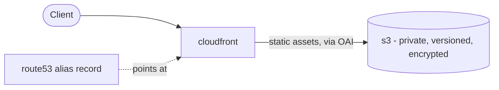
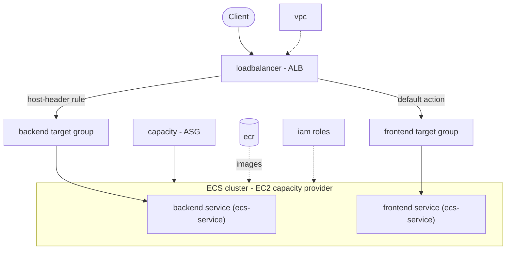
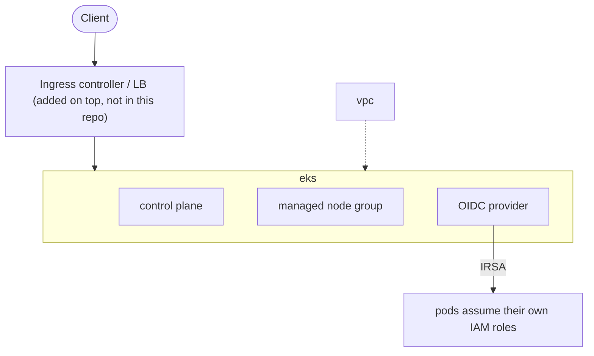
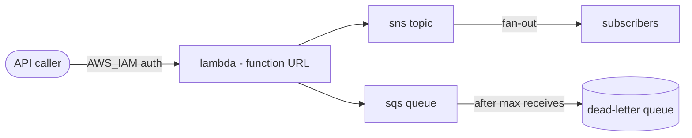
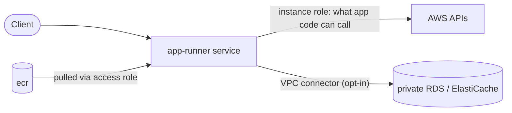
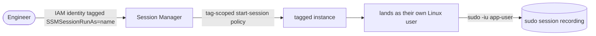

# Architecture patterns

The modules under [`aws/Modules/`](./aws/Modules/) are building blocks, not
opinions about how to assemble them. This doc is the opinion layer: five
real patterns, each a different shape of application, showing which modules
combine and why - so picking a starting point doesn't mean reading all eighteen
modules' source first.

None of these patterns are pre-wired root modules you can `terraform apply`
directly (see each module's own README section for why - mostly "this
project reads an existing VPC/cert/role as input, it doesn't create
everything for you"). They're a map, not a template.

## 1. Static site / SPA

**Modules:** `s3` → `cloudfront` → `route53`

The simplest pattern here - no compute at all. `s3` creates the bucket
(private, versioned, encrypted), `cloudfront` fronts it with an Origin
Access Identity (never OAC - see that module's README for the real incident
behind that choice), and `route53` points your domain at the distribution's
alias target. If the site has any dynamic/SSR piece, see pattern 2 or 4
instead - this pattern assumes a pure client-rendered or pre-built static
app.

## 2. Containerized API (EC2-backed ECS)

**Modules:** `vpc` → `iam` → `security`/`capacity`/`ecs-service`/`loadbalancer`/`ecr` (the root `aws/` module)

This is the pattern the root `aws/` module already *is* - it's the oldest,
most fleshed-out part of this repo, built from a real production migration.
`vpc`/`iam` are the standalone prerequisite-creation modules; the root
module's own submodules (`security`, `capacity`, `ecs-service`,
`loadbalancer`, `ecr`) do the actual ECS/ALB work. Use this pattern when you
want full control over the compute layer (bin-packing multiple containers
per instance, EC2 pricing, no cold starts) and are willing to manage a
capacity ASG.

## 3. Kubernetes platform

**Modules:** `vpc` → `iam` → `eks`

For teams that want Kubernetes instead of raw ECS. `eks` stands up the
control plane, a managed node group, and an OIDC provider so pods can
assume IAM roles directly instead of inheriting whatever the node's IAM
role can do. This module is deliberately independent of the ECS-pattern
modules - pick pattern 2 or pattern 3, this repo doesn't assume you're
running both compute models side by side.

## 4. Serverless event-driven backend

**Modules:** `lambda` + `sns` + `sqs` (+ `iam` if the execution role needs
something beyond the module's own least-privilege default)

No servers, no cluster, no ALB. `lambda`'s execution role starts with only
`AWSLambdaBasicExecutionRole` - wire `extra_execution_policy_arns` or an
`sqs`/`sns` module's ARN into it for whatever the function actually needs
to touch. `sqs`'s dead-letter queue and `sns`'s scoped topic policy mean a
failed or malformed event doesn't silently vanish or let anyone publish to
your topic.

## 5. Fully-managed containers, no cluster to manage

**Modules:** `ecr` → `app-runner` (+ `vpc` if using the private VPC connector)

The middle ground between pattern 2 (full control, more to manage) and
pattern 4 (no containers at all). App Runner handles the compute/scaling
entirely - `app-runner`'s job is just the IAM split (access vs. instance
role, see that module's README) and making private networking opt-in
rather than pushing you toward a publicly-exposed database.

## Cross-cutting: who can reach the servers

**Modules:** `ssm-access` (+ `capacity`'s launch template for the user data)

Applies to any pattern that has instances (2, and the node groups in 3).
Each person reaches a server as themselves instead of a shared `ssm-user`
or default login, only on instances tagged for access, and anything they do
as the app user is recorded under their name.

## Picking one

| If you need... | Pattern |
|---|---|
| A pure frontend, no backend | 1 |
| Full control over container placement/cost (EC2 pricing) | 2 |
| Kubernetes specifically (existing k8s tooling, multi-cloud portability) | 3 |
| No servers at all, pay only per invocation | 4 |
| Container simplicity without managing a cluster or capacity | 5 |

Patterns can combine - e.g. pattern 1's `cloudfront`/`s3` in front of
pattern 2's or 5's dynamic backend is exactly what the root `aws/` module's
own real-world origin (a migrated production app) looks like today.
